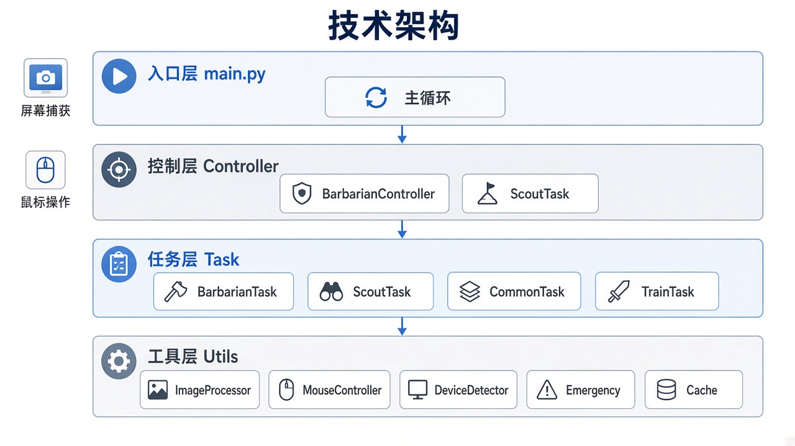
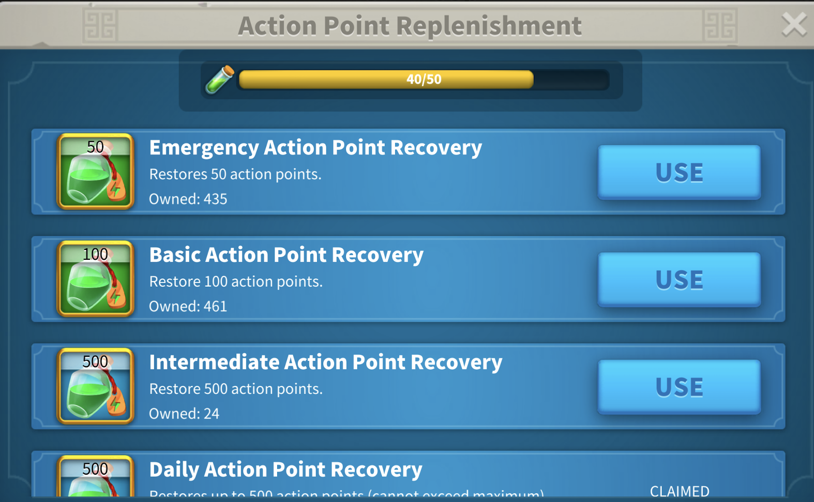
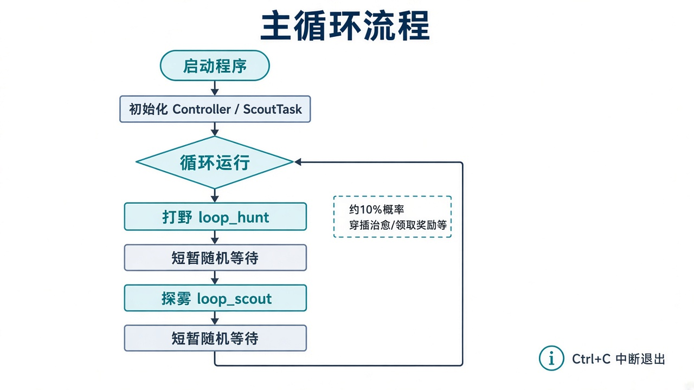

# Rise of Kingdoms 自动化助手

基于 **OpenCV 模板匹配 + PyAutoGUI** 的 macOS 桌面自动化脚本，用于《万国觉醒》（Rise of Kingdoms）日常挂机：打野、探雾，并穿插治愈、领奖、读信等「拟人」操作。

> ⚠️ **免责声明**：本项目仅供学习计算机视觉与桌面自动化技术使用。使用第三方自动化可能违反游戏服务条款，存在封号风险，请自行承担责任。

---

## 功能总览


### 主循环能力

| 功能 | 说明 |
|------|------|
| **打野** | 搜索并攻击蛮族：常规搜索调等级，或地图滚动定位；出征后走「行军 / 新建部队」分支，遇危险战取消 |
| **探雾** | 打开斥候营地 → 探索 → 派遣，循环清理地图迷雾 |

### 穿插侧任务（打野过程中约 10% 概率触发）

| 功能 | 说明 | 模板示例 |
|------|------|----------|
| 治愈伤兵 | 回城 → 医院 → 治疗，必要时快速补兵 |  |
| 联盟帮助 | 点击帮助按钮 | — |
| 表情互动 | 点击停滞部队旁表情 | — |
| 随机行军 | 地图随机点出征，干扰固定轨迹 |  |
| UI 奖励 | OCR 识别数量后连点领取 |  |
| 背包使用 | 打开背包，使用 / 叠加道具 | — |
| 邮件阅读 | 打开邮件，随机读报告 / 联盟 / 系统 | — |
| 任务奖励 | 打开任务面板领取 | — |
| VIP 奖励 | VIP 页领取 / 开木箱 | — |
| 联盟奖励 | 领地奖励 + 联盟礼物 | — |
| 村民奖励 | 地图拖拽后领取村民相关奖励 | — |

### 应急与防护

| 能力 | 说明 |
|------|------|
| 体力不足 | 检测补能界面，尝试领取 / 使用体力道具；耗尽则退出 |
| 弹窗清理 | 自动点击取消类按钮 |
| 中断恢复 | 居中点击、窗口移动后清缓存；连续中断 5 次退出 |
| 拟人鼠标 | 贝塞尔曲线、抖动、不规则路径与随机延迟 |

### 未完成 / 占位

- 练兵（`TrainTask.train`）— 空实现  
- 洞穴探索（`ScoutTask.scout_cave`）— 空实现  
- **反外挂检测绕过** — 尚未完成；设想方案是虚拟驱动，绕过对 API 调用的检测  

---

## 技术架构



### 分层说明

```
main.py                         # 入口：打野 ↔ 探雾 无限循环
 └─ Controller                  # 控制层编排
     └─ BarbarianController     # 打野调度、治愈、侧任务概率触发
         ├─ CommonController    # 找图标 / 点击 / 部队 OCR
         └─ Task                # 任务门面
              ├─ BarbarianTask  # 打野步骤
              ├─ ScoutTask      # 探雾
              ├─ CommonTask     # 奖励、邮件、背包等
              └─ TrainTask      # 练兵（未实现）
 └─ ScoutTask（主循环另建实例） # 探雾循环
```

| 层级 | 职责 | 关键文件 |
|------|------|----------|
| 入口 | 启动与主循环 | `main.py` |
| 控制层 | 调度打野节奏、部队上限、侧任务 | `core/controller/` |
| 任务层 | 具体游戏流程步骤 | `core/task/` |
| 工具层 | 截图匹配、鼠标、窗口、应急、缓存 | `core/utils/`、`core/cache/` |
| 资源 | UI 模板图 | `assets/icons/`（约 76 张）、`assets/views/` |

### 核心技术栈

| 组件 | 用途 |
|------|------|
| **OpenCV** (`matchTemplate`) | 屏幕与 `assets/icons` 模板匹配定位按钮 |
| **PyAutoGUI** | 截图、鼠标点击与移动 |
| **Pillow / NumPy** | 图像处理 |
| **EasyOCR + mss** | 识别部队数量、奖励数量等数字（未写入 `requirements.txt`，需另装） |
| **Quartz (PyObjC)** | macOS 获取 `RiseOfKingdoms` 窗口位置与尺寸 |

运行环境假设：**macOS + Retina（缩放系数 2.0）**，游戏窗口进程名 `RiseOfKingdoms`。

### 识别与点击链路

```
截取屏幕 →（可选 Cache）→ OpenCV 模板匹配 → 坐标 ÷ Retina 缩放
    → MouseController（曲线/抖动）→ 点击 → 随机等待
失败时 → EmergencyController（体力 / 取消弹窗 / 居中点击）
```

打野相关模板示例：

| 搜索 | 蛮族 | 攻击 | 行军 |
|:----:|:----:|:----:|:----:|
|  |  |  |  |

斥候相关：

| 斥候营 | 探索 |
|:------:|:----:|
|  |  |

体力不足参考界面（`assets/views/low_energy.png`）：



---

## 主循环流程



`main.py` 逻辑摘要：

1. 初始化 `Controller` 与 `ScoutTask`
2. `while True`：
   - `controller.barbarian.loop_hunt()` — 随机完成约 1～10 次打野；部队并发上限默认 2；约 10% 概率穿插治愈 / 侧任务；每 5～10 次切换打野方式；连续失败 5 次结束本轮
   - 随机等待 1～2 秒
   - `scout_task.loop_scout()` — 随机探雾约 1～10 次
   - 再随机等待，进入下一轮
3. `Ctrl+C` 优雅退出

### 打野两种策略

| 策略 | 步骤概要 |
|------|----------|
| **常规搜索** | 搜索图标 → 调节蛮族等级（+/-）→ Search → 点地图中心 → Attack → 行军 |
| **滚动找怪** | 缩放/滚动地图 → 点击斧头标记 → Attack → 行军 |

出征后优先 `stagnation`→`march2`，或 `new_troop`→`march`；若出现 `suicide_mission` / `hard_battle` 则取消。

---

## 目录结构

```
rise_of_kingdoms/
├── main.py                 # 程序入口
├── requirements.txt        # 依赖
├── readme.md
├── assets/
│   ├── icons/              # UI 模板（匹配用）
│   └── views/              # 参考大图（如体力不足）
├── core/
│   ├── config.json         # 可缓存图标列表
│   ├── controller/         # 控制层
│   ├── task/               # 任务层
│   ├── utils/              # 截图、鼠标、窗口、应急
│   └── cache/              # 图标匹配结果缓存
├── docs/images/            # README 配图
└── temp/                   # OCR 调试图、运行时缓存
```

---

## 快速开始

### 1. 环境

- macOS（当前实现依赖 Quartz 窗口检测与 Retina 坐标）
- Python 3.9+ 建议
- 已安装并打开《万国觉醒》，窗口标题 / 进程名为 `RiseOfKingdoms`
- 授予终端 / IDE **辅助功能**、**屏幕录制**权限（否则无法截屏与模拟鼠标）

### 2. 安装依赖

```bash
cd rise_of_kingdoms
python3 -m venv .venv
source .venv/bin/activate
pip install -r requirements.txt
# 代码中已使用但未写入 requirements 的包：
pip install mss easyocr pyobjc-framework-Quartz
```

### 3. 运行

```bash
python main.py
```

将游戏窗口置于可被截取的位置，脚本会打印「开始运行」并进入打野 ↔ 探雾循环。按 `Ctrl+C` 停止。

### 4. 常用配置

**`core/config.json`**

```json
{
  "cache_icons": []
}
```

在 `cache_icons` 中填入图标名后，匹配结果会写入 `temp/cache/icons/`（默认 TTL 约 1 小时），可减少重复全屏匹配。当前为空表示不启用图标缓存。

**代码内硬编码（可按需改）**

| 参数 | 位置 | 默认 |
|------|------|------|
| 最大并发打野部队 | `BarbarianController.max_troops` | `2` |
| 模板匹配阈值 | 各 `find_icon` / `quick_click_icon` | 约 `0.65`～`0.8` |
| Retina 缩放 | `DeviceDetector` | `2.0` |

---

## 实现原理简述

1. **窗口定位**：通过 macOS Quartz 枚举窗口，找到 `RiseOfKingdoms` 的屏幕矩形。  
2. **视觉识别**：对屏幕截图与 `assets/icons/*.png` 做 OpenCV 模板匹配，得到按钮中心坐标（Retina 下除以 2）。  
3. **拟人操作**：`MouseController` 在直达、曲线、停顿、折线等模式中随机选择，并加入抖动与随机等待，降低机械轨迹特征。  
4. **状态恢复**：弹窗、体力耗尽、窗口移动等由 `EmergencyController` 统一处理，避免卡死在异常 UI。  
5. **行为混杂**：打野主流程中随机插入治愈、领奖、读信等，避免长时间单一动作模式。

---

## 已知限制

- 仅面向 **macOS + Retina**；其他分辨率 / Windows 需改窗口检测与坐标缩放。  
- UI 改版后需更新 `assets/icons` 模板。  
- 反外挂 / 驱动级输入模拟尚未实现。  
- 练兵、洞穴探索仍为占位代码。

---

## License

个人学习用途。请遵守游戏服务条款与当地法律法规。
